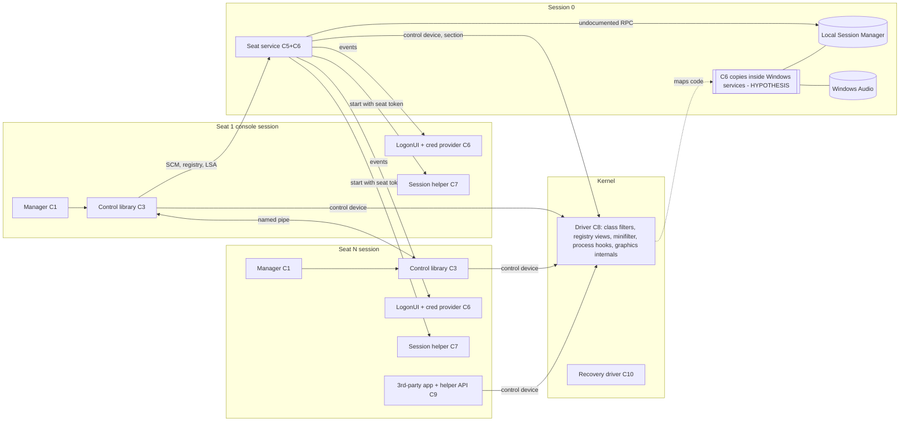
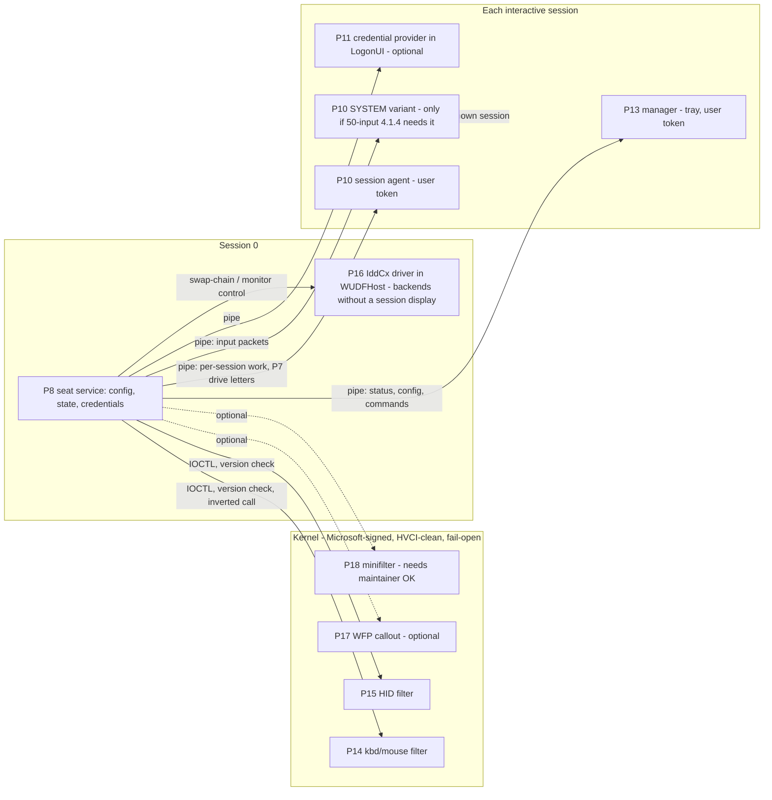
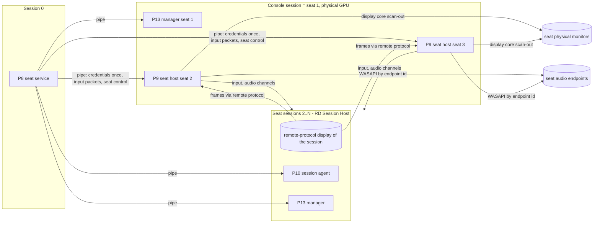

# 00 — Architecture

Status: draft v1 (2026-11-12, critiqued, cross-checked). Analyst-written. Behaviour and interfaces only;
see [../CLEANROOM.md](../CLEANROOM.md).

This file is the map. It ties together `10-manager.md` to `90-install.md`. It covers:

- the reference product's components, processes, services and drivers;
- where the drivers sit in the device stacks;
- how the parts talk to each other;
- what install and boot change on the PC;
- which Windows mechanisms the product uses, documented or not;
- signing, coexistence and legal concerns.

It ends with the **Pulsar Seat architecture proposal**: a component list mapped to the
monorepo layout, the backend question, and an ARM64 feasibility table for each component.

Sources: all other spec files (draft v1, critiqued); the shared analyst inventory; this
step's own static pass over every shipped binary (imports, exports, section layout,
interop markers); and read-only probes of the x64 test PC. On the test PC the reference
product 2.70.3 is installed but disabled. The 2.70.6 package was read statically and never
run. **Nothing of the reference product was ever seen running during this analysis.**

Evidence markers (used in every table and paragraph of this file):

| Marker | Meaning |
| --- | --- |
| **Observed** | Seen directly on the test PC (registry, files, service records, event logs) or in file headers (machine type, signature, sections). |
| **Static** | Read from the shipped binaries (import names, export names, string tables, structure). The capability is present in the code; that it is *used this way at run time* was not seen. |
| **HYPOTHESIS** | Inferred one step further: a role, a purpose, a sequence or a value that neither a probe nor a binary shows directly. |

A statement without a marker in sections 1–3 is **Observed**. Section 5 is Pulsar's own
design and carries no evidence markers, only HYPOTHESIS where it depends on an unverified
Windows behaviour.

---

## 1. Terms

| Term | Meaning |
| --- | --- |
| Seat | One workplace: monitor(s), keyboard, mouse, audio, USB ports. Seat 1 is the console seat. |
| Seat mask | One bit per seat, bit 0 = seat 1. All bits set = shared. 0 = spare. |
| Seat session | The Windows session that a seat's user works in. |
| Enabled / disabled | Product-wide switch. Enabled = the driver and the seat service start at boot and the class filters are in place (filter part **HYPOTHESIS**, §3.6). Switching needs a reboot. |
| Started | At run time, the extra seats' sessions exist. |
| Driver service key / seat service key | The reference's kernel driver key and seat service key under `HKLM\SYSTEM\CurrentControlSet\Services`. Their literal names are not needed by Pulsar and are not repeated here. The only place that needs them is the coexistence check of the Pulsar installer (`90-install.md`), which must detect an installed reference product. |
| Control library | The DLL that the manager and the console wizard load. It does all privileged work on the manager side. |
| Seat host (Pulsar) | A Pulsar process that shows one extra seat on its physical monitor(s) and feeds that seat's input and audio (section 5). |

---

## 2. Reference product: component inventory

Machine types (Observed): every binary is x64 except three x86 ones: the 32-bit app helper
DLL, the idle-seat screensaver of 2.70.6 (unsigned), and one legacy loader. **No ARM64
build exists of any part.** No binary is built with Control Flow Guard.

| # | Component | Kind | Runs where | Privilege | Role |
| --- | --- | --- | --- | --- | --- |
| C1 | Manager | Qt 6 GUI exe (packed with a commercial protector) | Every interactive session, one instance per session, tray-resident | User; asks for UAC elevation for some actions | All screens (`10-manager.md`). Started at every logon from the machine Run key with an autostart argument (Observed: Run value present). |
| C2 | Branding DLL | Small Qt DLL, 3 named exports | Manager process | Caller | Static: a brand factory export (product name, publisher, images from its resources) and two more entries, one for an instant-messaging helper and one for a support-ticket handler. It reads registry values and uses regular expressions and the current date. **HYPOTHESIS**: the two extra entries build contact / support links for the manager's help screens. Not needed by Pulsar. |
| C3 | Control library | DLL, 24 exports by ordinal only | Manager and console wizard processes | The caller's token; elevated for system changes | Static, from imports and strings: device inventory (SetupDi/CfgMgr32, HID caps, USB hub ports, container IDs); identify-by-touch (raw input, device notifications); monitor overlays (GDI regions); CCD display configuration; audio endpoints (MMDevice) and a test tone (waveOut); SCM create, change and control of both services; class filter list edits; credential provider registration; writes LSA private data (seat passwords); minifilter instance key; named-pipe server and client **with peer process-id checks** (client and server PID queries on the pipe); reads other processes' memory and image headers (process open, memory read, system process list, image directory lookup; **HYPOTHESIS**: to identify the peer process or a running manager copy); Authenticode trust checks; starts elevated copies through the shell; **restarts Windows** through the documented exit-Windows call (**HYPOTHESIS**: after enable and disable, which need a reboot); diagnostic report; all driver control calls of the manager. |
| C4 | Console wizard | Console exe | Started by setup on a fresh install, or by the manager | Elevated | First-run automatic layout: main keyboard/mouse by touch, extend the desktop, one seat per monitor, devices by hub and container (`10-manager.md` §9). Hands results to files under its own ProgramData folder. |
| C5 | Seat service host | Small service exe | Own process, LocalSystem, session 0 | SYSTEM | Service entry; also a command-line tool with maintenance actions (install, disable, delete, reset, recovery, legacy test-signing off). Static: checks code signatures, then loads C6. |
| C6 | Seat service logic | DLL linked with the force-integrity flag | (a) inside C5; (b) inside LogonUI as a COM credential provider (Static: COM server exports and provider key); (c) **HYPOTHESIS (strong)** mapped into Windows system service processes (§2.2) | SYSTEM / LogonUI | Static: session orchestration, auto-logon, console hand-over, per-seat helper, display ownership calls, input injection for the hotkey, Windows Update deferral values, credential provider. It exports only the four standard COM server entries. |
| C7 | Per-session helper | C5 started a second time with a start argument | Each seat session | SYSTEM token with the seat's session id (Static: create-process-as-user) | **HYPOTHESIS**: opens the interactive window station and input desktop and resets display modes (also after resume). |
| C8 | Kernel driver | x64 WDM driver, legacy (non-PnP) kernel service plus a placeholder root devnode | Kernel | Kernel | Eight jobs in one binary (§2.3). |
| C9 | App helper API | Two tiny DLLs (32- and 64-bit), 3 named exports | Third-party app processes | Caller | Seat count, seat of a process id, seat of a session id. Static: talks only to C8's control device. |
| C10 | Recovery driver (2.70.6) | Tiny x64 kernel driver, own temporary service | Kernel, at boot, only when armed (**HYPOTHESIS**) | Kernel | **HYPOTHESIS**: clears C8's configuration values so that a PC that no longer boots with C8 can recover (`20-service.md` §4.3). Static: its imports support that (open a key, delete a value). They also include physical-memory mapping (map and unmap I/O space, physical address of a virtual one, address validity), image-header parsing and system-module queries. **HYPOTHESIS**: it locates and inspects loaded kernel images in memory. That is a kernel-memory inspection capability far beyond "delete a value", and one more reason Pulsar builds nothing like it (§5.3). |
| C11 | Idle-seat screensaver (2.70.6) | x86 exe, unsigned | Seat sessions | User | Blanks an idle seat; Static: powers the monitor down through DDC/CI (`40-display.md` §3.11). |
| C12 | Compatibility helper (2.70.6 setup prerequisite) | Small x64 exe | Setup | Elevated | Signature and OS-version check before the driver is laid down. **HYPOTHESIS** for its exact checks (`90-install.md` §1.3). |
| C13 | Relay launcher | Two-line batch file | — | — | Starts the manager with an alternate vendor URL for networks that block the main site. Not needed by Pulsar. |
| C14 | Licence component | Separate exe and DLLs | — | — | Exists. Out of scope. |
| C15 | Legacy loader | Old x86 exe in an older folder | — | — | Left over from an older generation. Ignored. |

Version facts: 2.70.3 = driver build 76, seat table 12 seats. 2.70.6 = driver build 78,
two driver signing variants (§3.3), matching user-mode sets, recovery driver, idle
screensaver. A 16-seat table in 2.70.6 is a **HYPOTHESIS** (`30-sessions.md` §2).

### 2.1 Process and session map

All rows except "Kernel: C8 image present" are **Static / HYPOTHESIS** (never seen running).

| Session | Processes of the reference product |
| --- | --- |
| Kernel | C8 (always, while enabled); C10 (only when armed) |
| Session 0 | C5 + C6 (seat service) |
| Session 0, inside Windows services | **HYPOTHESIS (strong)**: copies of C6 in the Local Session Manager host, the Windows Audio service host and the display broker (§2.2) |
| Seat 1 (console session) | C1 manager (+ C3); LogonUI with C6 as credential provider while at the logon screen; C4 when run; C7 helper |
| Seat N (extra seat session) | C1 manager (+ C3); LogonUI with C6; C7 helper; C11 when idle |
| Any session | Third-party apps that load C9 |

### 2.2 In-process work inside Windows (exclusion list)

**HYPOTHESIS (strong)**, shared with `20-service.md` §3.1, `30-sessions.md` §3.11 and
`60-audio.md` §4.3. The evidence is static: the service logic's import set and its hook
table, the driver's process and image-load notifications, its address-space attach and its
virtual-memory and section-mapping calls into user processes.

The driver maps the service logic into the Local Session Manager, the audio service and
display clients. There it intercepts session and RPC paths, so that Windows accepts several
console-like local sessions and keeps per-seat audio state. A shared memory section links
these copies with the service process.

This is code injection into protected Windows processes. **Pulsar Seat builds none of it.**
It is listed only so that the implementer knows which behaviours must be reached another way.

### 2.3 The kernel driver's eight jobs

The reference puts everything into one WDM driver. Pulsar splits or drops each job
(section 5). The whole table is **Static** (imports and strings of the driver); the
"what it does" column is **HYPOTHESIS** where marked.

| Job | What it does (reference) | Mechanism | Pulsar |
| --- | --- | --- | --- |
| K1 Device filter | Seat-aware filtering of keyboards, mice, HID collections and display adapters | Class upper filter on 4 classes; attaches to device stacks | Replaced by INF-installed KMDF device filters for input only (§5.6) |
| K2 Seat ownership store | Seat masks on devnodes and per-display-source values | Device properties and `Control\Video` values | Service config + a private device property (`50-input.md` §4.1.1) |
| K3 Control device | Two control devices (main and safe) for manager, service and app helper | Buffered device I/O | Each Pulsar driver gets its own documented device interface; only the service opens it |
| K4 Registry views | **HYPOTHESIS**: per-seat views of the keys whose names appear in the driver's strings: logon, last-user, fast-startup, switch-user, device-install policy, audio-endpoint state, smart-card and Explorer volume-cache keys | Registry callback (Static) | Not built (`30-sessions.md` §6.2.11, `60-audio.md` design 4, `70-usb-devices.md` §5.3) |
| K5 Storage gate | Per-seat access to USB disks and optical drives | File-system minifilter; altitude 429999 (Observed in the instance key) | Device security descriptors first; own minifilter only with the maintainer's OK (`70-usb-devices.md` §5.2) |
| K6 Session and console | **HYPOTHESIS**: changes the kernel's notion of the active console session; client of the Local Session Manager's local RPC (Static: RPC client imports and interface markers) | Undocumented routines; kernel RPC client | Not built |
| K7 Process work | Process and image-load notifications; maps code into user processes; **HYPOTHESIS**: renames a single-instance object for one launcher (`80-apps-compat.md`) | Notify routines, address-space attach, section mapping (Static) | Not built (`80-apps-compat.md` §11.1) |
| K8 Graphics and network | **HYPOTHESIS**: lets a non-console session own physical display sources; binds a seat's apps to a source IP | Graphics-kernel and window-manager-kernel module references; the socket driver device name (Static) | Display: IddCx + presenter (`40-display.md` §6). IP: optional WFP callout (`80-apps-compat.md` §11.3) |

Further static facts: the driver verifies its own image signature with the kernel crypto
library. It registers for system power-state changes. It reads boot-safety values
(`LastBootSucceeded`, `ignoreLastBoot`, `OSBuild`, `chkLevel`).

---

## 3. Reference product: services, drivers, stacks, channels

### 3.1 Service and driver records (disabled state)

Observed in the service records and the service security descriptor on the test PC (the
service probe of `20-service.md`: service query, security-descriptor dump and the service
keys) and in this step's probe. Rows marked otherwise are not observed.

| | Kernel driver | Seat service | Recovery driver (2.70.6) |
| --- | --- | --- | --- |
| Type | 1 (kernel driver) | 0x10 (own process) | kernel driver (**HYPOTHESIS**: type 1) |
| Start when disabled | 4 | 4 | absent until armed (Observed: absent) |
| Start when enabled | **HYPOTHESIS**: ≤ 2 (static: setup treats boot, system or automatic as "enabled"); exact value unknown | **HYPOTHESIS**: automatic | — |
| Error control | 0 (ignore) | 1 (normal) | — |
| Group | none | `COM Infrastructure` | — |
| Dependencies | none | RPC (`RPCSS`), Local Session Manager (`LSM`) | — |
| Account | — | LocalSystem | — |
| Security descriptor | — | Windows default for a new service: SYSTEM and Administrators control it; **interactive users and service accounts may query it and send user-defined control codes** | — |
| Image | `system32\DRIVERS\<driver>.sys` (same size, version and signature as the file in the install folder; copied there by setup's helper, `90-install.md`) | quoted path of C5 in the install folder | `System32\drivers` (**HYPOTHESIS**) |
| Extras | `Instances` subkey (minifilter, altitude 429999, flags 0); many tuning DWORDs; `OSBuild`; `lastEnabled` | `KeyImage` = manager file name. Static: a volatile `link` subkey (registry symbolic link to the config root) with a `volatile` child at run time; absent while disabled (Observed) | — |
| Failure actions | — | none | — |
| SCM controls accepted | — | Static: 2.70.3 power events only; 2.70.6 power events and pre-shutdown. Not stop (`20-service.md` §4.4). | — |

Placeholder devnode: `ROOT\<DRIVER>_DEVICE\0000`, class LegacyDriver
`{8ECC055D-047F-11D1-A537-0000F8753ED1}`. It has no hardware ID and no function driver.
It is present but disabled: problem "disabled", config flag "disabled". There is no INF, no
catalog and no driver-store entry for any product driver, and setupapi logs never mention
the driver.

### 3.2 Device-stack positions

Observed: **no product entry exists in any class filter list while the product is
disabled**, and the minifilter is not registered with the filter manager. Every
"enabled" position below is therefore **Static** (class GUIDs and filter APIs in the
binaries) plus the other specs, not observed.

| Device class | Reference position (Static / HYPOTHESIS) | Purpose (HYPOTHESIS) | Source |
| --- | --- | --- | --- |
| Display adapter `{4d36e968-…}` | class upper filter on every display adapter | track adapters, link sources to seats, graphics-kernel work | `40-display.md` §3.2 |
| Keyboard `{4d36e96b-…}` | class upper filter; **HYPOTHESIS**: above kbdclass | route keyboard reads by session | `50-input.md` §2.5 |
| Mouse `{4d36e96f-…}` | class upper filter; **HYPOTHESIS**: above mouclass | route mouse reads by session | `50-input.md` §2.5 |
| HIDClass `{745a17a0-…}` | class upper filter | per-seat visibility of HID collections by usage; an unfiltered-usage list | `50-input.md` §2.5 |
| USB, Ports, MEDIA, Image, Camera, Xbox pad classes, Miracast | referenced only (class keys read; some option values exist, Observed) | inheritance below hubs (`propFilters`), serial ports, pads | `50-input.md`, `70-usb-devices.md` |
| File systems | FltMgr minifilter, altitude 429999 (Observed in the key), one default instance, create pre-operation only | gate opens on USB volumes by seat | `70-usb-devices.md` §3.4 |
| Registry | registry callback | per-seat views (K4) | 30, 60, 70 |
| Sockets | opens the socket driver device | source IP per seat | `80-apps-compat.md` §4.2 |

### 3.3 Coexistence seen on the test PC

All Observed; none of it belongs to the reference product, but each item matters to Pulsar.

| Area | What the test PC has | Why it matters |
| --- | --- | --- |
| Terminal Services | The `TermService` service DLL is **replaced by another vendor's terminal-service wrapper DLL** from a different multi-session product. Terminal Server values that allow several sessions and several sessions per user are set (by that product, not the reference). | Backend A (§5.2) runs on TermService. On a PC where TermService is wrapped, session behaviour is not stock Windows. Any session experiment on this test PC is not representative. The Pulsar installer must detect a non-default `TermService` service DLL and refuse or warn (`90-install.md`). |
| Input classes | A HID-hiding class filter on HIDClass and the Xbox pad classes; a third-party keyboard/mouse device filter; HID devices of another multi-input product | Pulsar's input filters (P14, P15) must coexist with other filters in the same stacks and never edit their entries. |
| USB class | USB capture and USB redirection filters | Hub-port inheritance and device identity must survive extra filters. |
| Storage | Third-party volume filters; a third-party file-system filter at altitude 429800, close to the reference's 429999 | A Pulsar minifilter (P18, exception) needs an officially allocated altitude. |
| Display | Two other vendors' indirect display drivers (one with many virtual sources) | P16 shares the IddCx space; the presenter must not grab other vendors' virtual targets. |

### 3.4 Signing and code integrity

| Build | Signature | Load behaviour |
| --- | --- | --- |
| 2.70.3 driver (installed) | Observed: vendor EV code-signing certificate only; the signature validates in user mode. **HYPOTHESIS**: the kernel trust path is the old cross-signed chain (no Microsoft signature is present) | **Observed: blocked at boot on the test PC.** The code-integrity log has 24 enforced-block events, 2026-08-03 to 2026-09-19: the boot loader refused the driver image under the in-box, enforced system policy "Microsoft Windows Endpoint Security Policy" `{60fd87f8-4593-44a0-91b0-2e0da022f248}`. Event values: requested signing level 4, validated signing level 1. In Windows' documented code-integrity signing-level numbering, 4 = Authenticode and 1 = unsigned. **HYPOTHESIS**: the image needed Authenticode-level kernel trust and was rated as unsigned because the vendor-only chain is no longer trusted for kernel code. This happened with Secure Boot **off**, Memory Integrity **off** and the code-integrity "upgraded system" flag set, on Windows 11 Pro build 26300. |
| 2.70.6 variant A | Static: vendor EV only | **HYPOTHESIS**: blocked the same way on current builds |
| 2.70.6 variant B | Static: Microsoft attestation signature only (Windows Hardware Compatibility Publisher) | **HYPOTHESIS**: passes the signing-level check on client Windows. With Memory Integrity on it most likely still fails, see below |
| Recovery driver | Static: dual, vendor + Microsoft attestation | **HYPOTHESIS**: loads |

Consequences:

- **HYPOTHESIS (strong):** this boot-time block is what the product reports as its Windows
  11 security-policy conflict (error class 2, code 31, `20-service.md` §9.3). Observed:
  while the driver was blocked, the manager logs showed many timed-out driver calls with
  Windows error 31. Static: the 2.70.6 installer probes one Microsoft policy with the
  code-integrity tool, but that policy id is not in this PC's policy list. Which policy id
  belongs to which build is open question 2.
- **HVCI readiness**, evidence ranked by weight (all Static, from the section table and
  imports of both builds of the main driver and of the recovery driver):
  1. **Decisive: a writable *and* executable section** (the init section). With Memory
     Integrity on, Windows refuses to load a driver image with a W+X section. **HYPOTHESIS
     (strong)**: so even variant B is refused with Memory Integrity on.
  2. Secondary: legacy pool allocators are imported (executable non-paged pool possible).
     That is not a load-time gate; it fails at run time (or in compatibility checks) only if
     executable pool is actually requested.
  3. Minor: the images are not marked NX-compatible. That flag is not the code-integrity
     gate; it is a hygiene signal checked by driver-compatibility tooling.
  This fits setup having a component that keeps Memory Integrity off (`90-install.md`
  §3.3). Attestation signing does not test HVCI compatibility.
- Static: a legacy path of the service host can switch Windows test-signing on or off and
  can import a test certificate into the machine's trusted-publisher store. Not seen in use.

### 3.5 Communication channels

All **Static** unless marked; none was seen at run time.

| # | Channel | From → to | Purpose |
| --- | --- | --- | --- |
| I1 | Service Control Manager | C3 (elevated), setup, C5 maintenance actions → both services | create, configure, enable/disable (start types), query |
| I2 | User-defined SCM control code | C3 → C6 | "configuration changed". Observed: the default service security descriptor lets any interactive user send such a code (§3.1). |
| I3 | Driver main control device | C3, C6, C9 → C8 | seat ownership, driver state and log, settings, seat-of-process/session queries |
| I4 | Driver safe control device | C3 → C8 | reduced path used in the driver's safe fallback (**HYPOTHESIS**) |
| I5 | Registry: config root, service key, driver key, symbolic link, volatile run-time key | C3 writes; C6 and C8 read; C6 publishes status that C3 reads | configuration in, status out |
| I6 | Device properties and `Control\Video` values | C3 and C8 | per-device and per-display-source seat ownership |
| I7 | Named events: OS "terminal services ready"; product resume, per-session context, pre-shutdown (2.70.6) | OS → C6; C6 → C7 and the credential provider | readiness, resume, shutdown, seat context ready |
| I8 | Shared memory section | C6 ↔ its copies inside Windows services ↔ C8 (**HYPOTHESIS** for the copies and for C8) | seat and session table |
| I9 | Local Session Manager local RPC (two interfaces) | C6 and C8 → LSM | session create, connect and disconnect, console hand-over (undocumented) |
| I10 | Session-manager port and Winlogon message calls | C6 → Windows | session creation and logon/logoff messages (undocumented) |
| I11 | Child processes | C6 → C7; C1 → C5 maintenance actions | exit codes as results |
| I12 | Named pipes (server and client) with peer process-id checks | inside C3 → between manager instances (**HYPOTHESIS**: an unelevated manager and an elevated copy, or seat managers) | not recovered. **The seat service has no pipe code at all.** |
| I13 | LSA private data | C3 writes, C6 reads | per-seat auto-logon passwords |
| I14 | ProgramData files | C3/C4 write; C3 reads | assignment snapshot, report, logs, wizard handoff (Observed: files present) |
| I15 | Credential provider in LogonUI | LogonUI → C6 | per-seat auto-logon, last user per seat |

Shape: in the reference, the **manager side does the privileged work directly** (C3 writes
the SCM records, class filters, LSA secrets and driver state, and restarts Windows). The
seat service mostly orchestrates sessions, and the driver enforces. No single component
owns the configuration.

### 3.6 Component diagram (reference)

Static / HYPOTHESIS; never seen running.

### 3.7 Install, enable and boot changes

Detail in `90-install.md` and `20-service.md`.

| When | Changes | Evidence |
| --- | --- | --- |
| Install | Files in Program Files; driver image in `System32\drivers`; legacy driver service; placeholder root devnode; minifilter instance key; seat service; machine Run entry for the manager; firewall allow rules (in and out) for the manager; Defender exclusion for the install folder (option); fast startup off, sleep off, small crash dumps, restore point (options); a component that keeps Memory Integrity off; VC++ runtime; an older generation removed if found | Observed for files, services, devnode, instance key, Run entry; options and the Memory Integrity component per `90-install.md` (partly HYPOTHESIS there) |
| Enable | Both start types ≤ 2; reboot | Static (start-type logic); exact values **HYPOTHESIS** |
| Enable | Product added to the class upper-filter lists of Display, HIDClass, Keyboard and Mouse; credential provider registered | **HYPOTHESIS** (`20-service.md` post-install section, `90-install.md`): never observed, the PC was only seen disabled |
| Enable | Seat service added to `EarlyStartServices`; display class written into the device-install deny policy | **HYPOTHESIS** (Static: both names appear in the control library) |
| Run time (service start) | Volatile symbolic link and run-time keys; shared section; events | Static |
| Run time (service start) | Windows Update deferral values written; 2.70.6: the Windows Update engine module blocked while enabled | Static (value names and module name in the service logic); **HYPOTHESIS** that it happens at service start |
| Run time | The in-process changes of §2.2 | **HYPOTHESIS** |
| Settings apply | Per-device seat markers, per-display-source values, per-seat audio endpoint-state copies under the Windows endpoint store, Winlogon values per seat (through the registry views) | Static / **HYPOTHESIS**; some per-device option values Observed |
| Disable | Both start types 4; filters and credential provider removed. Files, devnode and most settings stay. Reboot | Observed end state (start types 4, no filters, no provider); the transition itself not observed |
| Reset action | Removes the per-device, per-display and per-endpoint markers and the per-seat subkeys | Static |

The reference's start-up sequence is described behaviourally in `20-service.md` (boot
section) and `30-sessions.md` §3.2, all **Static / HYPOTHESIS**. It is not repeated here.
Pulsar's own boot steps (§5.7) are derived from Pulsar's needs, not from that sequence.

### 3.8 Windows mechanisms used

All Static.

| Area | Documented, user mode | Documented, kernel | Undocumented or internal (never copy) |
| --- | --- | --- | --- |
| Sessions | WTS enumeration, `CreateProcessAsUser`, credential provider interfaces, LSA private data, Winlogon auto-logon values | — | LSM local RPC, session-manager port, Winlogon messages, active-console change, in-process hooks in LSM |
| Display | CCD, GDI display settings, D3DKMT source-owner thunks, DDC/CI | PnP class filter | graphics-kernel and window-manager-kernel internals, in-memory modification |
| Input | Raw input, HID parsing, `SendInput` | class filters, device attach, requestor session id | console-state change |
| Audio | MMDevice enumeration, waveOut test tone | registry callback (endpoint state views) | in-process hooks in the audio service and audio policy |
| USB / storage | SetupDi/CfgMgr32, hub IOCTLs, device-change notifications | minifilter, device properties | — |
| Processes | process open + memory read, pipe peer PID queries | process/image notify | kernel mapping into processes, object rename, socket-driver hook, physical-memory mapping (C10) |
| Install / power | SCM, Run key, firewall, Defender exclusion, power settings, exit-Windows restart | legacy service + placeholder devnode (documented but discouraged) | test-signing toggle, trusted-publisher import, Memory Integrity kept off, Windows Update engine block |

### 3.9 Legal and licensing concerns

These are notes for the maintainer, not legal advice.

1. **Concurrent sessions on client Windows.** The reference gives several people their own
   interactive sessions on Windows Pro. Microsoft's client licence terms generally allow one
   user at a time. Supported multi-user setups use Windows Server with Remote Desktop
   Services and RDS client access licences. This is a release blocker and needs a decision
   (`30-sessions.md` §4, `docs/agents/plan.md`). It is shared with Pulsar Split.
2. **RDS licensing on Server, and the "fully free" goal.** Under backend A (§5.2) every
   Pulsar install needs a **paid Windows Server licence plus an RDS CAL per user or device**
   after the grace period. The plan says Pulsar Seat is fully free. Pulsar itself stays
   free, but backend A makes the *working setup* cost money. This conflict must be stated
   in the installer, the docs and the backend decision (open question 1).
3. **Clean room.** Pulsar copies behaviour, not code. Raw notes, binaries and decompiler
   output stay outside the repo (CLEANROOM.md). The reference's driver and service bypass
   or weaken Windows protections (§2.2, §3.4). Copying any of that would also be a security
   and reputation risk for Pulsar.
4. **Names and assets.** No vendor names, images, wallpapers or UI copy. Interop
   identifiers (registry value names, the JSON field names of the assignment snapshot, the
   reference's service key names in the installer's detection list) may appear only where
   an importer or detector needs them.
5. **Third-party code.**
   - The main public WDK driver-samples repository is published under the **Microsoft
     Public License (MS-PL)**. The FSF lists MS-PL as a free licence that is **incompatible
     with the GPL**. So sample code cannot be copied into GPL-3 Pulsar drivers as-is. Using
     the samples only as documentation (reading, then writing fresh code) is the safe
     default. Individual samples may carry other licences; check each one.
   - The open-source Rust Windows-driver crates are dual MIT / Apache-2.0; Apache-2.0 is
     compatible with GPL-3.
   - The open-source RDP client library named in `30-sessions.md` is Apache-2.0,
     compatible with GPL-3.
   - Keep all notices.
6. **Driver signing accounts.** Attestation signing needs a Partner Center hardware account
   and an EV code-signing certificate (paid). Full WHCP (HLK) certification needs HLK test
   runs per OS family. The account terms are the maintainer's.
7. **Anti-cheat and DRM.** Pulsar adds nothing to game processes. HDCP content does not show
   on indirect displays (`40-display.md` §6.6).
8. **Security policy.** Pulsar never asks users to turn off Secure Boot, Memory Integrity,
   the vulnerable-driver blocklist or any code-integrity policy. It never blocks Windows
   Update (`10-manager.md`, `90-install.md` §11).

---

## 4. ARM64 notes

- **Nothing of the reference runs natively on ARM64.** The x64 kernel drivers cannot load
  at all: Windows on ARM never emulates kernel code. The user-mode parts would run only
  under x64 emulation and would have nothing to talk to.
- The in-process approach (§2.2) is impossible on ARM64 even in principle. Native ARM64
  system processes (LSM, audio service, LogonUI, display broker) load only ARM64 or ARM64X
  binaries.
- LogonUI is native: a credential provider must be an ARM64 DLL, or ARM64X if it must also
  load into emulated x64 processes (`30-sessions.md` §5).
- All documented mechanisms Pulsar needs exist natively on ARM64: SCM, WTS, LSA,
  credential providers, raw input, HID, SetupDi/CfgMgr32 and `CM_Register_Notification`,
  CCD, D3DKMT thunks, `Windows.Devices.Display.Core`, DXGI/D3D11, IddCx (UMDF 2), KMDF,
  UMDF, FltMgr, WFP, WASAPI/MMDevice, Media Foundation, named pipes, job objects and CPU
  sets, DPAPI.
- **Windows Server with RDS is not generally available for ARM64** (**HYPOTHESIS**: check
  current availability). Any backend that needs it (backend A) does not exist on ARM64
  today. Under rules.md, ARM64 therefore gets only backends C and D unless a client-SKU
  multi-session backend is found. This is the biggest ARM64 gap of the whole design.
- ARM64 PCs typically have one integrated GPU, I2C/SPI HID keyboards, touchpads and touch
  screens, ACX/SoundWire audio, MIPI cameras, USB-C/DP alt-mode outputs and MST docks.
  Location paths often start at an ACPI node. HVCI is on by default and Secure Boot is
  usually on and often not user-switchable. These facts drive 40, 50, 60 and 70.
- Driver development on the ARM64 dev laptop cannot use test-signing without turning
  Secure Boot off, which rules.md forbids (§5.8).
- Every Pulsar binary is built for `aarch64-pc-windows-msvc` and `x86_64-pc-windows-msvc`
  (drivers: ARM64 and x64 in one multi-architecture package). CI checks the PE machine type
  (0xAA64 / 0x8664). The app helper DLL also ships x86 and ARM64EC/ARM64X builds.
- Installer architecture detection uses the native machine query, not the WOW64
  environment variable (`90-install.md` §10).

---

## 5. Pulsar Seat approach — architecture proposal

### 5.1 Principles

1. **The service owns everything privileged.** One Rust service holds the configuration,
   the seat state machine, the device assignment, seat credentials and all system changes,
   including any reboot request. The manager is an unprivileged client over one ACL'd named
   pipe. This is the reverse of the reference, where the manager writes system state
   directly (§3.5).
2. **User mode first.** Kernel code is used only where no user-mode or UMDF path exists. Each
   kernel piece is small, KMDF, INF-installed, Microsoft-signed, HVCI-clean and fails open
   (`50-input.md` §4.1.5).
3. **Documented interfaces only.** No injection, no patching, no undocumented RPC, no
   registry views of Windows keys, no test-signing (not for users, and not on the dev
   laptop either, §5.8). Rules from `docs/agents/rules.md`.
4. **One seat-session abstraction.** Sessions (30), display (40), input delivery (50) and
   audio (60) all depend on one undecided question: how an extra seat gets a session. The
   architecture isolates it behind one backend interface, so the decision can be made later
   without rewriting the rest. **No backend is the default architecture until the
   maintainer decides** (open question 1).
5. **Native on ARM64 and x64**, the same code, the same package layout. A component that
   works only on x64 or only on Server needs the maintainer's explicit OK and is marked so
   in every table.

### 5.2 Seat-session backends

| Backend | What a seat is | Where it works | Status |
| --- | --- | --- | --- |
| A. Server RDS loopback | A remote-protocol session per seat. A Pulsar seat host connects to it and shows it on the seat's monitors. | Windows Server with the RD Session Host role. In practice x64 only. | **Candidate, needs the maintainer's OK** for being x64/Server-only and for the Server + CAL cost (§3.9 items 1–2). Not the default. |
| C. Fast user switching | One active session at a time | Everywhere, incl. ARM64 | Rule-clean fall-back; the only multi-user mode on ARM64 today |
| D. Desktop-in-session (kiosk / guest seats) | Separate desktops or windows inside one session, with no per-user isolation | Client SKUs, ARM64 | Rule-clean; possible main mode for client SKUs (`30-sessions.md` §6.1) |
| B. Console-type local sessions like the reference | — | — | **Excluded** (needs §2.2 mechanisms) |

Backend interface operations (names are ours): prepare host, create seat session, attach to
the seat's outputs, detach, log off, query state, deliver input, bind audio. Each backend
declares which of them it supports. The manager greys out what is missing.

**Where a seat's frames come from**, per backend:

- A: the seat session renders into the remote-protocol session's own display; the seat
  host receives the frames through the remote-protocol client and presents them on the
  seat's physical targets. The Pulsar IddCx driver (P16) is not used for that seat.
- C: the console session is shown on all monitors; no frames are moved.
- D: windows or desktops of one session are placed on the seat's monitors; P16 adds
  virtual monitors where a seat needs a monitor of its own that the session can render to,
  and the presenter scans them out to the seat's physical targets (`40-display.md` §6.3).

Which case is real is decided together with the backend (open question 1; T1).

#### 5.2.1 Backend A requirements (if the maintainer chooses it)

An implementer needs all of these. Facts are public Windows Server behaviour; unverified
items are marked.

- **Session count.** Without the RD Session Host role, Windows Server allows only two
  concurrent administrative remote sessions. More seats need the RD Session Host role, an
  RD Licensing server and CALs (§3.9 item 2).
- **Loopback.** The in-box remote desktop client refuses to connect to the local machine
  through `localhost` / the main loopback address. **HYPOTHESIS**: an alternate loopback
  address (another address in 127.0.0.0/8) or a custom client built on the RDP client
  library is accepted. Must be prototyped first.
- **Seat 1 relative to the seat hosts (T6).** The seat hosts are ordinary processes and
  need an interactive session with access to the physical monitors: the console session.
  Either seat 1's own console session hosts them (seat 1 keeps native GPU performance but
  its user can see or kill them), or a dedicated host session owns the console and seat 1
  also becomes a remote-protocol seat. Prototype both (`30-sessions.md` §6.1.1).
- **Credentials and NLA.** Each seat host logs on to its seat session with that seat's
  user. With Network Level Authentication on, the credentials are needed before the
  session exists. They come from the service (§5.5.1), never from a file.
- **RDS policies to set and document** (through documented policy values, recorded and
  reverted by the installer): use the hardware graphics adapter for remote sessions;
  graphics codec and frame-rate settings suited to a local link; audio playback and
  recording redirection on (audio design 3, `60-audio.md`); drive, printer, clipboard,
  smart-card and USB redirection per seat policy (`70-usb-devices.md`); session time-outs
  off; one session per user unless the maintainer allows same-account seats. **HYPOTHESIS**
  for the exact policy set; verify on a Server test install.
- **Coexistence.** If `TermService` has a non-default service DLL (§3.3), backend A is
  refused with a clear message.
- **Signing.** Windows Server does not accept attestation-signed drivers; it requires
  WHCP-certified (HLK-tested) drivers. Under backend A, P14, P15 and P17 need full HLK
  certification on Server. **This is a cost and schedule risk**: HLK setup, test runs per
  driver and per OS family, and resubmission for every driver change (§5.8).
- **Input limits.** See T3: local XInput / GIP / GameInput pads may not reach a
  remote-protocol session at all (**HYPOTHESIS**, `50-input.md` §4.1.4 / q8), and those
  pads are opened by shared system processes, so per-seat isolation of them is not solved.
  Touch and pen reach a remote-protocol session only through its touch/pen input channel;
  **HYPOTHESIS** that the client library and the session support multi-touch and pen
  fully. HID pads that the seat host opens itself can be forwarded as input of that seat.

### 5.3 Component list and monorepo layout

Names are proposals. `crates/` = Rust libraries and binaries, `apps/` = manager,
`drivers/` = driver packages, `installer/` = packaging.

| ID | Component | Path | Kind | Runs where | Phase | Replaces (reference) |
| --- | --- | --- | --- | --- | --- | --- |
| P1 | Core model | `crates/seat-core` | Rust lib | everywhere | 1 | config parts of C3/C6 |
| P2 | IPC protocol | `crates/seat-ipc` | Rust lib | service, manager, agents, hosts | 1 | I2, I12 |
| P3 | Device inventory | `crates/seat-devices` | Rust lib | service | 1 | enumeration part of C3 |
| P4 | Display control | `crates/seat-display` | Rust lib | service, seat host | 3 | display part of C3/C6, K8 |
| P5 | Session backends | `crates/seat-session` | Rust lib | service | 2 | C6 session code, K6 |
| P6 | Audio | `crates/seat-audio` | Rust lib | seat host, manager | 5 | audio part of C3, K4 audio |
| P7 | Storage and devices | `crates/seat-storage` | Rust lib | service, session agent | 5 | K5 |
| P8 | Seat service | `crates/seat-service` | Rust bin, Windows service, LocalSystem | session 0 | 1 | C5 + C6 (orchestration) |
| P9 | Seat host | `crates/seat-host` | Rust bin | console or host session, one per extra seat (backend A; backend D variant shows a seat's desktop) | 2–5 | (no equivalent; the reference used the console hand-over) |
| P10 | Session agent | `crates/seat-agent` | Rust bin | each seat session, user token; a SYSTEM-token variant in the same session only where `50-input.md` §4.1.4 requires it | 2 | C7, parts of C1 |
| P11 | Credential provider (optional) | `crates/seat-credprov` | COM in-proc DLL | LogonUI of seat sessions | 2, only if needed | C6 credential provider |
| P12 | App seat API (optional) | `crates/seat-api` | DLL (cdylib) | third-party apps | later | C9 |
| P13 | Manager | `apps/manager` | Tauri 2 + SvelteKit + Svelte 5 (`adapter-static`) | every interactive session, user token, tray-resident | 1 | C1, C3, C4 |
| P14 | Keyboard/mouse filter | `drivers/kbdmou-filter` | KMDF device upper filter below kbdclass/mouclass | kernel | 4 | K1 (input) |
| P15 | HID visibility filter | `drivers/hid-filter` | KMDF upper filter on HID collection devnodes | kernel | 4 | K1 (HID) |
| P16 | Virtual display | `drivers/idd` | IddCx UMDF 2 driver | WUDFHost, session 0 | 3, if the backend needs it | K8 (display) |
| P17 | Source-IP callout (optional) | `drivers/wfp-callout` | KMDF WFP callout at the ALE bind-redirect layers | kernel | later, maintainer decision | K8 (network) |
| P18 | Storage minifilter | `drivers/storage-minifilter` | FltMgr minifilter | kernel | **not in the plan; needs the maintainer's explicit OK** (outside the rules.md driver list) | K5 |
| P19 | Installer | `installer/` | MSI (WiX) or a signed bundle, one per architecture or one bundle that picks the native one | — | 1 | setup, C12 |

Responsibilities:

- **P1 Core model**: Seat table, seat masks, device keys (location key + collection discriminator, display key, endpoint key), config document with schema version and migrations, importer for the reference assignment snapshot (optional).
- **P2 IPC protocol**: Versioned, length-prefixed messages on named pipes; version handshake first; caller identity from the pipe client's token and process id; request authorisation table (admin / own seat / read-only).
- **P3 Device inventory**: SetupDi/CfgMgr32 walk, USB hub ports, container IDs, HID caps, `CM_Register_Notification` hot-plug, inheritance by hub.
- **P4 Display control**: CCD query/apply, stable display keys, target acquisition and scan-out through `Windows.Devices.Display.Core`, DDC/CI power.
- **P5 Session backends**: Backend interface (§5.2); WTS enumeration and notifications; seat ↔ session ↔ user map; backends C and D first, A only after the maintainer's OK.
- **P6 Audio**: Endpoint keys, WASAPI test tone, per-seat audio bridge (backend A: client-side audio redirection back-end that opens the seat's endpoint by id, `60-audio.md` design 3).
- **P7 Storage and devices**: Device security descriptors, volume lock/dismount, per-logon-session drive letters, printer ACLs (`70-usb-devices.md` §5.2).
- **P8 Seat service**: Owns config, state and seat credentials; pipe server; seat state machine; boot sequence; safety (safe mode, unclean shutdown, crash counter); driver control with version check; reboot requests (asks the user through the manager, then restarts through the documented shutdown API); Event Log source; diagnostic report (never includes secrets); sub-commands install/uninstall/enable/disable/reset/status (`20-service.md` §13).
- **P9 Seat host**: backend A: remote-protocol client for one seat, presenter on the seat's physical targets, input forwarding into the connection from service-forwarded packets, audio bridge. Started by the service in the console or host session; the service checks its token and process id on the pipe.
- **P10 Session agent**: Per-session work: wallpaper, notices (same-account warning), per-session drive letters, per-user options; reports to the service. The SYSTEM-token variant exists only for input delivery when no remote-protocol input channel exists (`50-input.md` §4.1.4). It injects **only through documented user-mode injection** (`SendInput` / synthetic pointer injection) from a process running in the target session on its input desktop. Never driver-level injection into another session's input stream, never a console-state change.
- **P11 Credential provider (optional)**: Last user per seat, seat-aware tile. Only if the chosen backend's auto-logon is not enough (`30-sessions.md` §6.2.7). Registered only while enabled.
- **P12 App seat API (optional)**: "Which seat am I on" through the service pipe; never talks to a driver.
- **P13 Manager**: All screens of `10-manager.md`, the setup wizard inside the app (no console exe), tray, overlays for monitor identification. Turkish copy. Talks only to P8. Autostart: §5.7.
- **P14 Keyboard/mouse filter**: Seat 1 packets pass through; other seats' packets go to the service by inverted call; fail open before the first service connect (`50-input.md` §4.1.2).
- **P15 HID visibility filter**: Decides on create by requestor session; never touches data (`50-input.md` §4.1.3).
- **P16 Virtual display**: Virtual monitors per seat, render-adapter choice, hardware cursor (`40-display.md` §6.3).
- **P17 Source-IP callout (optional)**: Binds a seat's apps to a chosen source address through documented WFP bind-redirect; only if the maintainer wants the feature.
- **P18 Storage minifilter**: Only if device security descriptors cannot gate file opens (`70-usb-devices.md` §5.2(4)) **and** the maintainer approves the exception. Needs an officially allocated altitude.
- **P19 Installer**: Files, service, driver packages through the driver store, Run entry, Event Log source, coexistence checks (reference product present; non-default `TermService` DLL; other multi-seat filters), uninstall that removes everything (`90-install.md` §11).

Not built: anything like C10 (recovery driver with physical-memory mapping; replaced by
fail-open filters and documented offline removal), C11 (idle screensaver; the presenter
or the session agent blanks idle seats), C13, C14, C15.

### 5.4 Component diagrams (Pulsar)

Backend-neutral core (all backends):

Backend A variant (pending the maintainer's OK). Seat hosts shown in seat 1's console
session; the alternative is a separate host session (T6):

### 5.5 IPC

- **One pipe server, in the service.** The pipe has an explicit security descriptor:
  SYSTEM and Administrators read/write; interactive users only the requests that the
  authorisation table allows. Every request is checked against the caller's token (from the
  pipe), not against a file name. For service-started processes (seat hosts, SYSTEM agent)
  the service also checks the client process id against the process it started. The
  admin-only policy is enforced here.
- Clients: the manager (every session), the seat hosts, the session agents, the optional
  credential provider and app API. The manager never talks to drivers. Nothing talks
  manager-to-manager.
- Per-session signals: the service creates events in the session namespace with an ACL
  when needed. There is no global writable section and no registry symbolic link.
- Status lives in the service's memory and is served over the pipe. It is never stored in
  volatile registry keys.
- Configuration changes are pipe requests ("apply", "reload"), never an unauthenticated
  SCM control code. The Pulsar service has an explicit service security descriptor; it
  does not rely on the default one that lets interactive users send control codes.

#### 5.5.1 Seat credentials (secrets)

Seat-user passwords are needed for per-seat auto-logon (all backends) and, under backend A,
for the seat host's logon with NLA.

- **Store**: LSA private data owned by the service, one entry per seat, under Pulsar's own
  key names. Readable only by SYSTEM (and, by Windows design, by administrators with LSA
  policy rights). Never in the config file, ProgramData, the registry outside LSA, logs or
  the diagnostic report. Machine-scope DPAPI blobs in a SYSTEM-only file are an
  acceptable alternative; Credential Manager is not used (it is per user).
- **Write-only from the manager**: the manager can set or clear a seat's password over the
  pipe (admin requests only). No request returns a password.
- **Use**: the service reads the secret only when it logs a seat on. Under backend A it
  hands the secret once, over the pipe, to the seat host it started itself (token and PID
  checked), which uses it for the connection and wipes it from memory. A seat host never
  stores it.
- **Rules.md**: agents and tests never read, print or copy these secrets.

#### 5.5.2 Driver interface versioning and upgrades

- Every Pulsar driver's device interface starts with a version query IOCTL that returns an
  interface version and the driver build version. The service refuses to use a driver whose
  interface major version differs from its own, leaves the filter in fail-open state and
  reports it (manager notice, Event Log).
- IOCTL changes are additive within a major version; a new major version is a new
  interface GUID, so an old service never misreads a new driver.
- One product version covers service, manager and driver packages (plan: one version, one
  release). The service also checks the pipe protocol version of every client (P2).
- **Upgrade path**: the installer stops the service (filters fail open, seats keep running
  as far as the backend allows, or are logged off with a notice), replaces user-mode
  files, stages the new driver packages through the driver store, restarts the service.
  A loaded filter is replaced at the next device restart or reboot; until then the service
  runs against the old driver only if its interface major version still matches,
  otherwise it stays in fail-open mode and asks for a reboot. Downgrade follows the same
  rule. **HYPOTHESIS**: replacing an input filter without a reboot by restarting the
  devices is acceptable to users; to be tested.

### 5.6 Device-stack positions (Pulsar)

| Stack | Pulsar position | Install method | Reference for comparison |
| --- | --- | --- | --- |
| Keyboard, mouse (USB HID, I2C/SPI HID, PS/2) | KMDF **device** upper filter, below kbdclass/mouclass, above kbdhid/mouhid/i8042prt | extension INF with a filter-add directive (or a device `UpperFilters` entry from the INF); never a class-wide entry; never editing class lists from a service | class upper filter (Static) |
| HID collections (touch, pen, pads, consumer, system control) | KMDF upper filter on collection devnodes | extension INF matched on HID hardware IDs | HIDClass class filter (Static) |
| Display adapters | **none** | — | class filter + graphics-kernel work (Static) |
| Virtual monitors | IddCx UMDF adapter, root-enumerated through a documented software-device or INF root install with a real hardware ID | INF + driver store | LegacyDriver placeholder (Observed) |
| Storage | none by default (device security descriptors on disk and volume devnodes); minifilter P18 only with the maintainer's OK | INF, allocated altitude | minifilter 429999 |
| Registry | none | — | registry callback (Static) |
| Network | none by default; optional WFP callout P17 | INF | socket-driver hook (Static) |
| Audio, cameras, smart cards | none | — | registry views (Static) |

All filters:

- never remove, reorder or rewrite other software's entries in any filter list (§3.3);
- leave the PC usable at seat 1 when the service is not running;
- are removed by uninstall through the driver store.

### 5.7 Install, enable, boot

- **Install** (`90-install.md` §11): Program Files, ProgramData with an ACL of SYSTEM +
  Administrators full and Users read; the service; driver packages through the driver store;
  an Event Log source; a machine-wide Run entry (Pulsar's own value name) that starts the
  manager with a tray argument in every interactive session, including seat sessions. The
  manager is single-instance per session (a session-local named object), so a second start
  in the same session only brings the window forward. Uninstall removes the entry. There
  are no firewall rules (local pipe only), no Defender exclusions, and no changes to
  security, Windows Update or power settings. Optional system tweaks are explicit,
  recorded and reverted. Coexistence checks run first (§3.3, P19).
- **Enable / disable** is a service state, not a rewrite of system filter lists. A reboot
  is needed only when a driver package is first installed, upgraded across an interface
  major version, or removed. Per-seat behaviour turns on and off at run time.
- **Boot**, derived from what Pulsar itself needs:
  1. The service starts (automatic, own name, LocalSystem). It depends on RPC (the pipe and
     WTS need it) and LSM (WTS session data); under backend A also on TermService.
  2. Safety first: in safe mode it does nothing but serve status (a user fixing a broken PC
     must get a plain single-seat Windows). After its own crash counter passes a limit, or
     after an unclean previous shutdown, it does not start extra seats automatically and
     says so in the manager, so that a crash loop cannot lock the user out.
  3. It needs the devices it will assign and the session layer it will create sessions
     on, so it waits for device enumeration, the audio services and the session layer.
     It uses SCM and WTS notifications, never fixed sleeps.
  4. It applies device ownership (writes its private seat properties, connects to the
     filters after the version check), so that no extra seat's input reaches seat 1.
  5. It starts the seats with per-seat time-outs. Serial or parallel is a backend
     property, chosen by measurement, not fixed here.
  6. Each failure becomes a structured event: seat, step, Windows error code
     (`20-service.md` §13.3).
- **Service down**: filters fail open before the first connect. After a connect they drop
  other seats' input rather than leak it to seat 1 (`50-input.md` §4.1.5). SCM recovery
  actions restart the service, and it re-adopts existing seat sessions.
- **Recovery**: online driver package removal, and a documented offline WinRE procedure. No
  "panic" kernel driver.

### 5.8 Signing plan

The finding in §3.4 changes the risk picture: a vendor-only kernel driver no longer loads
on current Windows 11 builds, even with Secure Boot and Memory Integrity off. So:

- Every Pulsar kernel driver (P14, P15, optional P17, P18 if approved) needs a **Microsoft
  signature**: attestation signing on client Windows; **full WHCP (HLK) certification on
  Windows Server**, which does not accept attestation-signed drivers. Backend A therefore
  implies HLK certification of every kernel driver (§5.2.1): a cost and schedule item for
  the backend decision.
- Every kernel driver must also be **HVCI-clean**: no writable+executable sections (the
  decisive load gate), non-executable pool only, NX-compatible flag, `/INTEGRITYCHECK`,
  Driver Verifier and the WDK code-integrity checks in CI. Signing alone does not prove this
  (the reference's attestation-signed build most likely fails it, §3.4).
- UMDF drivers (P16) also need a signed catalog. Attestation signing covers them on client
  Windows.
- One multi-architecture driver package per driver (ARM64 + x64), signed in one submission
  where possible.
- User-mode binaries are Authenticode-signed. The credential provider (P11), if built, is
  native per architecture.
- **Developer loop.** Test-signing needs Secure Boot off, which rules.md does not allow on
  the maintainer's ARM64 laptop (and §5.1 principle 3 excludes it). Options, in order of
  preference:
  1. attestation-signed preview builds of each driver, tested with Secure Boot and Memory
     Integrity on;
  2. a separate, disposable test VM (x64, or ARM64 under Hyper-V) with test-signing on
     inside the VM only. **This needs the maintainer's explicit OK**, because it is still a
     DSE work-around, even if confined to a VM; it never touches the dev laptop or the test
     PC.
  Phases 1–3 need no kernel driver, so this decision can wait until Phase 4.
- **If signing cannot be obtained** (cost, account): ship without P14/P15. Extra seats then
  have no local-input isolation and the manager says so (`50-input.md` §4.2). Never fall back
  to test-signing or to asking users to change security settings.

### 5.9 ARM64 and x64 feasibility per component

| Component | Native ARM64 build | Windows mechanism on ARM64 | Risk / note (ARM64 and x64) |
| --- | --- | --- | --- |
| P1 core, P2 IPC, P3 devices | yes (pure Rust + `windows` crate) | SetupDi, CfgMgr32, HID, pipes: all native | ACPI location paths; I2C/SPI HID without USB parents |
| P4 display control | yes | CCD, D3DKMT, `Windows.Devices.Display.Core`, DDC/CI: native | **HYPOTHESIS**: specialized-display scan-out, cursor planes and DDC/CI over USB-C on ARM64 GPU drivers; must be tested |
| P5 session backends | yes (code) | WTS, LSM, TermService native | **Backend A needs Windows Server RDS, not generally available on ARM64 (HYPOTHESIS)**. Today ARM64 gets only backends C/D. x64: backend A needs Server + CALs + maintainer OK. |
| P6 audio | yes | WASAPI, MMDevice native | per-seat audio exists only with backend A (T2); the RDP client library must build for ARM64 |
| P7 storage | yes | device security descriptors, mount manager, DOS-device namespaces: native | same open questions as x64 (`70-usb-devices.md` §6) |
| P8 service | yes | SCM incl. pre-shutdown and power events, LSA, DPAPI | modern standby instead of S3 on many ARM64 laptops: test resume handling |
| P9 seat host | yes, if the RDP client library builds for ARM64 (**HYPOTHESIS**: the candidate does) | Display Core, WASAPI, Win32 | only useful where backend A exists; **input limits on both architectures**: XInput / GIP / GameInput pads may not reach the seat session, touch and pen only through the remote-protocol channel (**HYPOTHESIS**, T3) |
| P10 session agent | yes | Win32, `DefineDosDevice`, wallpaper API, `SendInput` | must not run under emulation; check machine type. SYSTEM variant uses documented injection only |
| P11 credential provider | yes: ARM64, or ARM64X if needed in emulated x64 processes | LogonUI native ARM64 | ARM64X build tooling in Rust: **HYPOTHESIS**, may need a C++ shim |
| P12 app API | yes: ARM64 + ARM64EC/ARM64X, plus x64 and x86 | pipe client | many games are x64 under emulation |
| P13 manager | yes (Tauri 2 + WebView2 ARM64) | WebView2, Media Foundation | none known |
| P14 kbd/mouse filter | yes (KMDF ARM64) | KMDF, documented filter position | attestation signing on client (ARM64 too); HLK on Server; I2C/SPI and vendor HID-over-SPI stacks must be tested; dev loop without test-signing (§5.8) |
| P15 HID filter | yes (KMDF ARM64) | KMDF | as P14; touch and pen on one I2C device (collection discriminator); does not solve XInput/GIP pads |
| P16 IddCx driver | yes (UMDF 2 ARM64) | IddCx native | render adapter is always the single integrated GPU; frame-transport prototype (`40-display.md` §6.3) |
| P17 WFP callout | yes (KMDF ARM64) | WFP native | extra signed driver; optional; HLK on Server |
| P18 minifilter | technically yes (FltMgr native) | FltMgr | **outside the rules.md driver list: needs the maintainer's explicit OK** before any work; needs an altitude and signing |
| P19 installer | yes: per-arch MSI or a bundle that picks by native machine | MSI, driver store | ARM64 VC++ runtime or static CRT; no High-performance power plan on many ARM64 laptops |

Build language for drivers: C written fresh against the WDK documentation (the sample
repository is MS-PL, §3.9 item 5), or Rust with the open-source Windows driver crates.
ARM64 KMDF/UMDF support of the Rust driver tooling is a **HYPOTHESIS** to check before
choosing. Either way the package is INF + CAT for ARM64 and x64.

### 5.10 Mapping to the plan's phases

| Phase (`docs/agents/plan.md`) | Components |
| --- | --- |
| 1 Manager + service, seat model, inventory, config, start/stop, status | P1, P2, P3, P8, P13, P19 (no drivers) |
| 2 Concurrent sessions, auto-logon per seat | backend decision first; P5 (C/D, A only with OK), P9 skeleton if A, P10, P11 if needed, seat credentials (§5.5.1) |
| 3 Display per seat | P4, P9 presenter (A) or P16 + presenter (D) |
| 4 Input isolation | P14, P15, input path of P9 / P10; signing route and dev loop decided (§5.8) |
| 5 Audio and USB | P6, P7; P18 only with the maintainer's OK |
| later | P12, P17 |

### 5.11 Not copied from the reference

Code injection and in-process hooks in Windows services; kernel mapping into user processes;
physical-memory mapping and kernel-image inspection; graphics-kernel and window-manager-kernel
internals; active-console changes; undocumented LSM, session-manager and Winlogon
interfaces; registry views of Windows keys; legacy-service drivers without an INF and
placeholder LegacyDriver devnodes; class-wide input filters written by a service;
test-signing and trusted-publisher certificate imports; keeping Memory Integrity off;
Windows Update blocking and silent deferral; device-install deny policies; firewall rules
and Defender exclusions; an "Everyone full control" data folder; a service that cannot be
stopped; an unauthenticated "apply settings" control code on a default service security
descriptor; privileged writes from the manager process; reading other processes' memory;
the console hand-over at every seat start.

---

## 6. Cross-spec tensions to resolve

| # | Tension | Where | Proposed resolution |
| --- | --- | --- | --- |
| T1 | Display of seats 2..N via IddCx + presenter (40) vs via the RDP session's own display (30, backend A) | 30 §6.1, 40 §6.3 | Under backend A, the seat host presents the remote-protocol frames; IddCx only for backends without a session display (§5.2). Decide with backend. |
| T2 | Audio design 3 exists only with backend A | 60 §8 | Same decision as T1; on client SKUs and ARM64 there is no rule-clean per-seat audio today. |
| T3 | Input delivery assumes remote-protocol input channels | 50 §4.1.4, q8 | Same decision. Under backend A: XInput / GIP / GameInput pads may not be visible in the seat session and are opened by shared system processes (**HYPOTHESIS**); touch and pen only through the remote-protocol touch/pen channel (**HYPOTHESIS**). v1 isolates HID pads only. The SYSTEM-agent injection path (documented `SendInput` only) is built only if another backend is chosen. |
| T4 | ARM64-first rule vs backend A being Server/x64-only | 30 §6.1, rules.md | Maintainer decision (open question 1). Until then, backends C and D are the only approved ones on both architectures. |
| T5 | Minifilter is outside the rules.md driver list | 70 §5.3, 90 §11 | Exception only with explicit OK; default is descriptors only. Resolved in the final pass: `90-install.md` §11 now also calls it an exception, like `70-usb-devices.md` §5.3 and §5.3/§5.9 here. |
| T6 | Seat 1 as physical console vs a host console session under backend A | 30 §6.1.1, 40 §6.2 | Seat hosts run in seat 1's console session (seat 1 keeps the native GPU) or in a host session (seat 1 becomes a remote seat). Prototype first (§5.2.1). |
| T7 | Backend A signing: Server needs HLK, not attestation | 90 §3.3, §5.8 | Part of the backend decision; budget HLK if A is chosen. |
| T8 | "Fully free" plan vs Server + CAL cost of backend A | plan, §3.9 | Part of the backend decision; state it in docs and installer. |

---

## 7. Open questions

1. **Backend decision** (shared with Pulsar Split): accept backend A as an x64/Server-only
   backend (with Server + CAL cost and HLK signing), make D the main mode, or hold Phase 2?
   This fixes T1–T4 and T6–T8.
2. Which Windows builds enforce the in-box code-integrity policy that blocked the vendor-only
   driver on the test PC ({60fd87f8-…}, "Endpoint Security Policy")? How does it relate to the
   policy id that the 2.70.6 installer probes (8F9CB695-…, absent on the test PC)? Does an
   attestation-signed (not WHQL) driver pass it on client builds? This sets the minimum
   signing route for Pulsar's drivers on client Windows.
3. Does the attestation-signed reference driver load with Memory Integrity on? Static layout
   says probably not (§3.4). Not needed for Pulsar's design; it would confirm the
   HVCI-readiness rule.
4. Exact start type of the reference driver and service while enabled; whether the class
   filters, `EarlyStartServices` and the device-install deny policy are written; when the
   credential provider is registered. Needs an enabled snapshot of the test PC, which is a
   system change and needs the maintainer's approval.
5. Who is authoritative for the seat ↔ session map in the reference (driver or service)?
   Not needed for Pulsar (the service is authoritative), but it explains the app helper API.
6. Does the reference's named pipe connect an unelevated manager to an elevated copy, or
   managers on different seats? Not needed for Pulsar (no manager-to-manager channel).
7. Does Windows Server with RDS exist for ARM64 in any form that Pulsar can target?
8. Can Rust driver tooling build KMDF and UMDF/IddCx drivers for ARM64 today, or must
   drivers be C written fresh against the WDK documentation?
9. The WDK sample repository is MS-PL, which the FSF lists as GPL-incompatible. Does the
   maintainer accept "samples as documentation only, no copied code" as the rule? Are any
   individual samples under a GPL-compatible licence?
10. Where should the presenter of a seat run under backend A: inside the seat host in the
    console or host session (proposed), or in session 0? (`40-display.md` §7 q2.)
11. Do Pulsar Seat and Pulsar Split share the service skeleton, IPC crate and session-backend
    crate? (`docs/agents/plan.md` open question.) This spec proposes crate boundaries (P2,
    P5, P8) that would allow it.
12. Backend A loopback: which address or client configuration does Windows Server accept for
    a remote-protocol connection to itself, and does NLA work for it? Needs a Server test
    install (not the test PC: its `TermService` is wrapped by another product, §3.3).
13. Which RDS policy set (hardware GPU for remote sessions, codec, redirections, time-outs)
    gives local-quality seats? To measure on a Server test install.
14. Developer loop for kernel drivers: attestation-signed previews only, or a test-signing VM
    with the maintainer's explicit OK (§5.8)?
15. Seat credentials: LSA private data or machine DPAPI file (§5.5.1)? Both are
    SYSTEM-only; LSA private data is the default proposal.
16. Can an input filter be upgraded without a reboot by restarting its devices, and is that
    acceptable to users (§5.5.2)?
